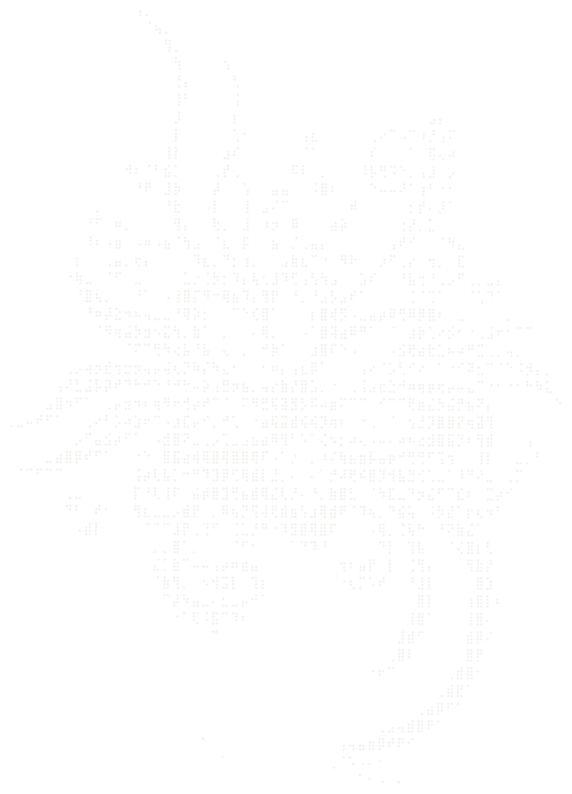
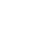
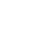
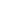

### hi im eva!

current high school sophomore interested in **computational neurology** and **AI/ML**. I enjoy learning and making things :)

### Selected work

#### [Cereva](https://github.com/evadiva3/Cereva)

Built an iOS-first migraine app with visual aura reconstruction, local storage, and model-assisted drafting.

#### [Neuroimaging research](https://github.com/evadiva3/fm-subtype-discovery)

Studied the calibration and sensitivity of cluster tests on normalized neuroimaging representations, with graph ML and fMRI pipelines.

<samp>~~~~~~~~~~</samp>

"And the universe said you are the universe tasting itself, talking to itself, reading its own code

And the universe said I love you because you are love.

And the game was over and the player woke up from the dream. And the player began a new dream. And the player dreamed again, dreamed better. And the player was the universe. And the player was love." -End Poem

 

 

## Tech stack

<table>
  <tr>
    <td valign="top">
      <h4>Languages</h4>
      

      
      
      
      
      
       
      
      
      
      
      

      Python · Rust · TypeScript · JavaScript R · Swift · HTML · CSS · Bash
    </td>
  </tr>
</table>

<table>
  <tr>
    <td valign="top">
      <h4>Research & machine learning</h4>
      

      
      
      
      
      
       
      
      
      

      PyTorch · PyTorch Geometric scikit-learn · NumPy · SciPy · pandas Matplotlib · Nilearn · NiBabel · UMAP Statsmodels · Optuna · Ray Tune
    </td>
  </tr>
</table>

<table>
  <tr>
    <td valign="top">
      <h4>Apps & interfaces</h4>
      

      
      
      
      
      
      
      
      
      

      React · React Native · Expo · Tauri · Next.js · Tailwind CSS · Vite · Zod · HealthKit Canvas 2D
    </td>
  </tr>
</table>

<table>
  <tr>
    <td valign="top">
      <h4>Backends & model APIs</h4>
      

      
      
      
      
      
      

      FastAPI · Pydantic · Uvicorn · SQLite / SQL · Anthropic API · Ollama
    </td>
  </tr>
</table>

<table>
  <tr>
    <td valign="top">
      <h4>Tools & testing</h4>
      

      
      
      
      
      
      
      
      
       
      
      
      
      
      
      
      
      

      Git · GitHub · GitHub Actions · Docker · QEMU · Node.js · VS Code · Figma · Codex Claude Code · Jupyter · pytest · Jest · ESLint · Ruff
    </td>
  </tr>
</table>

 

 

## GitHub activity

  
  &nbsp;
  

Updated daily from GitHub

 

