

<a href="assets/angel-dark.gif#gh-dark-mode-only">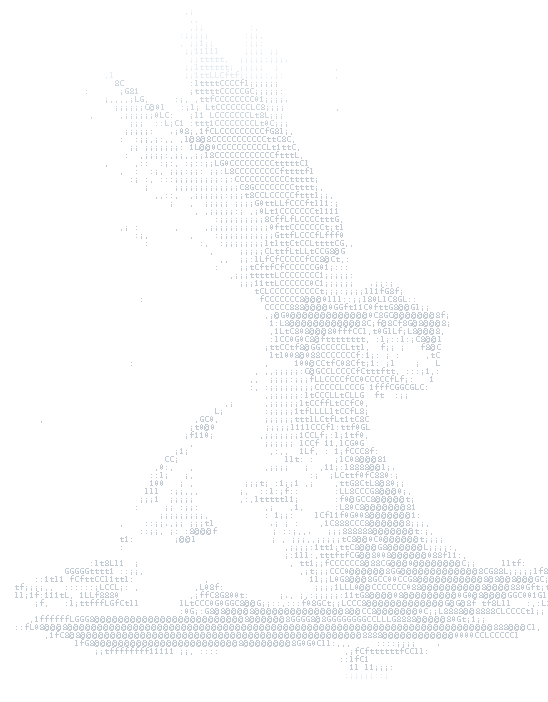</a><a href="assets/angel-light.gif#gh-light-mode-only">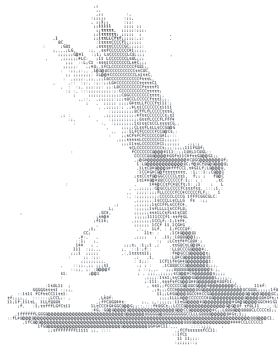</a>

<h1 align="center">eva</h1>

high school sophomore interested in <b>computational neurology</b> and <b>AI/ML</b>. 
i also code for fun.

<a href="https://github.com/evadiva3/fm-subtype-discovery">research</a> &nbsp; / &nbsp;
<a href="https://github.com/evadiva3/Cereva">cereva</a> &nbsp; / &nbsp;
<a href="https://github.com/evadiva3?tab=repositories">repositories</a>

 

## SELECTED WORK

### [Cereva](https://github.com/evadiva3/Cereva)

Built an iOS-first migraine app with visual aura reconstruction, local storage, and model-assisted drafting.

### [Neuroimaging research](https://github.com/evadiva3/fm-subtype-discovery)

Studied the calibration and sensitivity of cluster tests on normalized neuroimaging representations, with graph ML and fMRI pipelines.

 

<a href="assets/hands-dark.gif#gh-dark-mode-only">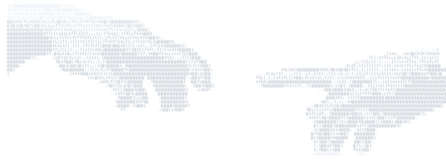</a><a href="assets/hands-light.gif#gh-light-mode-only">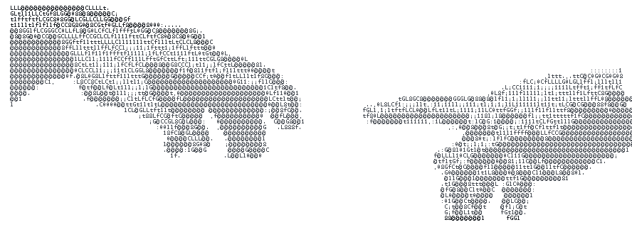</a>

 

## TECH STACK

#### Languages

  &nbsp;
  &nbsp;
  <a href="assets/icons/typescript-dark.svg#gh-dark-mode-only">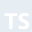</a>&nbsp;
  <a href="assets/icons/javascript-dark.svg#gh-dark-mode-only">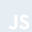</a>&nbsp;
  &nbsp;
  &nbsp;
  &nbsp;
  <a href="assets/icons/css-dark.svg#gh-dark-mode-only">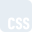</a>&nbsp;
  &nbsp;

Python · Rust · TypeScript · JavaScript · R · Swift · HTML · CSS · Bash

#### Research & machine learning

  &nbsp;
  &nbsp;
  &nbsp;
  &nbsp;
  &nbsp;
  &nbsp;
  &nbsp;

PyTorch · PyTorch Geometric · scikit-learn · NumPy · SciPy · pandas · Matplotlib · Nilearn · NiBabel · UMAP · Statsmodels · Optuna · Ray Tune

#### Apps & interfaces

  &nbsp;
  &nbsp;
  &nbsp;
  &nbsp;
  &nbsp;
  &nbsp;
  &nbsp;
  &nbsp;

React · React Native · Expo · Tauri · Next.js · Tailwind CSS · Vite · Zod · HealthKit · Canvas 2D

#### Backends & model APIs

  &nbsp;
  &nbsp;
  &nbsp;
  &nbsp;
  <a href="assets/icons/ollama-light.svg#gh-light-mode-only">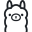</a>&nbsp;

FastAPI · Pydantic · Uvicorn · SQLite / SQL · Anthropic API · Ollama

#### Tools & testing

  &nbsp;
  &nbsp;
  &nbsp;
  &nbsp;
  &nbsp;
  &nbsp;
  &nbsp;
  &nbsp;
  &nbsp;
  &nbsp;
  &nbsp;
  <a href="assets/icons/pytest-dark.svg#gh-dark-mode-only">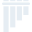</a>&nbsp;
  &nbsp;
  &nbsp;
  <a href="assets/icons/ruff-dark.svg#gh-dark-mode-only">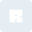</a>&nbsp;

Git · GitHub · GitHub Actions · Docker · QEMU · Node.js · VS Code · Figma · Codex · Claude Code · Jupyter · pytest · Jest · ESLint · Ruff

 

## GITHUB ACTIVITY

<a href="assets/stats-dark.svg#gh-dark-mode-only"></a>
<a href="assets/top-langs-dark.svg#gh-dark-mode-only"></a>

Updated daily from GitHub.

 

 
 

<a href="assets/bunny-dark.gif#gh-dark-mode-only">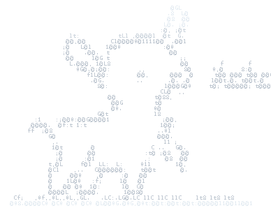</a><a href="assets/bunny-light.gif#gh-light-mode-only">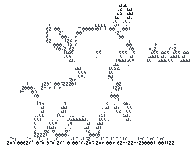</a>
&nbsp;&nbsp;&nbsp;&nbsp;&nbsp;&nbsp;&nbsp;&nbsp;
<a href="assets/cat-dark.svg#gh-dark-mode-only">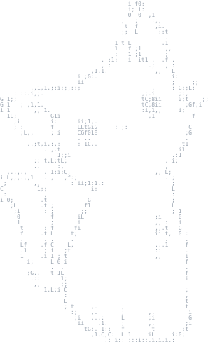</a><a href="assets/cat-light.svg#gh-light-mode-only">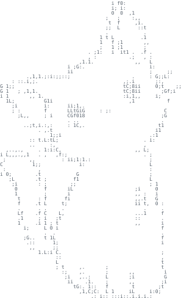</a>

