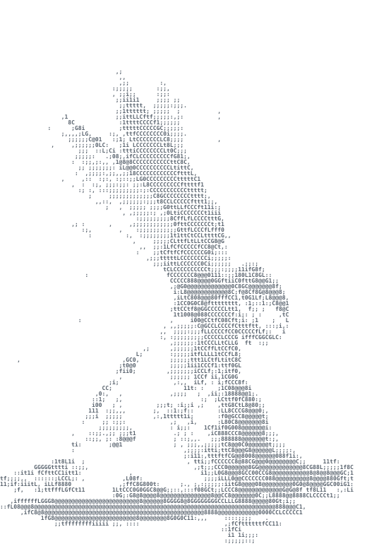
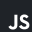
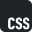
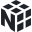
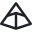
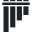

<picture>
  <source media="(prefers-color-scheme: dark)" srcset="assets/ascii-dark.svg" />
  
</picture>

# eva

high school sophomore interested in **computational neurology** and **AI/ML**. i also code for fun.

[research](https://github.com/evadiva3/fm-subtype-discovery) · [cereva](https://github.com/evadiva3/Cereva) · [repositories](https://github.com/evadiva3?tab=repositories)

 

### selected work

**[Cereva](https://github.com/evadiva3/Cereva)** 
Built an iOS-first migraine app with visual aura reconstruction, local storage, and model-assisted drafting.

**[Neuroimaging research](https://github.com/evadiva3/fm-subtype-discovery)** 
Studied the calibration and sensitivity of cluster tests on normalized neuroimaging representations, with graph ML and fMRI pipelines.

### stack

**languages**

  <picture><source media="(prefers-color-scheme: dark)" srcset="assets/icons/python-dark.svg" /></picture>&nbsp;
  <picture><source media="(prefers-color-scheme: dark)" srcset="assets/icons/rust-dark.svg" /></picture>&nbsp;
  <picture><source media="(prefers-color-scheme: dark)" srcset="assets/icons/typescript-dark.svg" /></picture>&nbsp;
  <picture><source media="(prefers-color-scheme: dark)" srcset="assets/icons/javascript-dark.svg" /></picture>&nbsp;
  <picture><source media="(prefers-color-scheme: dark)" srcset="assets/icons/r-dark.svg" /></picture>&nbsp;
  <picture><source media="(prefers-color-scheme: dark)" srcset="assets/icons/swift-dark.svg" /></picture>&nbsp;
  <picture><source media="(prefers-color-scheme: dark)" srcset="assets/icons/html5-dark.svg" /></picture>&nbsp;
  <picture><source media="(prefers-color-scheme: dark)" srcset="assets/icons/css-dark.svg" /></picture>&nbsp;
  <picture><source media="(prefers-color-scheme: dark)" srcset="assets/icons/gnubash-dark.svg" /></picture>&nbsp;

Python · Rust · TypeScript · JavaScript · R · Swift · HTML · CSS · Bash

**research & machine learning**

  <picture><source media="(prefers-color-scheme: dark)" srcset="assets/icons/pytorch-dark.svg" /></picture>&nbsp;
  <picture><source media="(prefers-color-scheme: dark)" srcset="assets/icons/scikitlearn-dark.svg" /></picture>&nbsp;
  <picture><source media="(prefers-color-scheme: dark)" srcset="assets/icons/numpy-dark.svg" /></picture>&nbsp;
  <picture><source media="(prefers-color-scheme: dark)" srcset="assets/icons/scipy-dark.svg" /></picture>&nbsp;
  <picture><source media="(prefers-color-scheme: dark)" srcset="assets/icons/pandas-dark.svg" /></picture>&nbsp;
  <picture><source media="(prefers-color-scheme: dark)" srcset="assets/icons/optuna-dark.svg" /></picture>&nbsp;
  <picture><source media="(prefers-color-scheme: dark)" srcset="assets/icons/ray-dark.svg" /></picture>&nbsp;

PyTorch · PyTorch Geometric · scikit-learn · NumPy · SciPy · pandas · Matplotlib · Nilearn · NiBabel · UMAP · Statsmodels · Optuna · Ray Tune

**apps & interfaces**

  <picture><source media="(prefers-color-scheme: dark)" srcset="assets/icons/react-dark.svg" /></picture>&nbsp;
  <picture><source media="(prefers-color-scheme: dark)" srcset="assets/icons/reactnative-dark.svg" /></picture>&nbsp;
  <picture><source media="(prefers-color-scheme: dark)" srcset="assets/icons/expo-dark.svg" /></picture>&nbsp;
  <picture><source media="(prefers-color-scheme: dark)" srcset="assets/icons/tauri-dark.svg" /></picture>&nbsp;
  <picture><source media="(prefers-color-scheme: dark)" srcset="assets/icons/nextdotjs-dark.svg" /></picture>&nbsp;
  <picture><source media="(prefers-color-scheme: dark)" srcset="assets/icons/tailwindcss-dark.svg" /></picture>&nbsp;
  <picture><source media="(prefers-color-scheme: dark)" srcset="assets/icons/vite-dark.svg" /></picture>&nbsp;
  <picture><source media="(prefers-color-scheme: dark)" srcset="assets/icons/zod-dark.svg" /></picture>&nbsp;

React · React Native · Expo · Tauri · Next.js · Tailwind CSS · Vite · Zod · HealthKit · Canvas 2D

**backends & model APIs**

  <picture><source media="(prefers-color-scheme: dark)" srcset="assets/icons/fastapi-dark.svg" /></picture>&nbsp;
  <picture><source media="(prefers-color-scheme: dark)" srcset="assets/icons/pydantic-dark.svg" /></picture>&nbsp;
  <picture><source media="(prefers-color-scheme: dark)" srcset="assets/icons/sqlite-dark.svg" /></picture>&nbsp;
  <picture><source media="(prefers-color-scheme: dark)" srcset="assets/icons/anthropic-dark.svg" /></picture>&nbsp;
  <picture><source media="(prefers-color-scheme: dark)" srcset="assets/icons/ollama-dark.svg" /></picture>&nbsp;

FastAPI · Pydantic · Uvicorn · SQLite / SQL · Anthropic API · Ollama

**tools & testing**

  <picture><source media="(prefers-color-scheme: dark)" srcset="assets/icons/git-dark.svg" /></picture>&nbsp;
  <picture><source media="(prefers-color-scheme: dark)" srcset="assets/icons/github-dark.svg" /></picture>&nbsp;
  <picture><source media="(prefers-color-scheme: dark)" srcset="assets/icons/githubactions-dark.svg" /></picture>&nbsp;
  <picture><source media="(prefers-color-scheme: dark)" srcset="assets/icons/docker-dark.svg" /></picture>&nbsp;
  <picture><source media="(prefers-color-scheme: dark)" srcset="assets/icons/qemu-dark.svg" /></picture>&nbsp;
  <picture><source media="(prefers-color-scheme: dark)" srcset="assets/icons/nodedotjs-dark.svg" /></picture>&nbsp;
  <picture><source media="(prefers-color-scheme: dark)" srcset="assets/icons/vscode-dark.svg" /></picture>&nbsp;
  <picture><source media="(prefers-color-scheme: dark)" srcset="assets/icons/figma-dark.svg" /></picture>&nbsp;
  <picture><source media="(prefers-color-scheme: dark)" srcset="assets/icons/codex-dark.svg" /></picture>&nbsp;
  <picture><source media="(prefers-color-scheme: dark)" srcset="assets/icons/claude-dark.svg" /></picture>&nbsp;
  <picture><source media="(prefers-color-scheme: dark)" srcset="assets/icons/jupyter-dark.svg" /></picture>&nbsp;
  <picture><source media="(prefers-color-scheme: dark)" srcset="assets/icons/pytest-dark.svg" /></picture>&nbsp;
  <picture><source media="(prefers-color-scheme: dark)" srcset="assets/icons/jest-dark.svg" /></picture>&nbsp;
  <picture><source media="(prefers-color-scheme: dark)" srcset="assets/icons/eslint-dark.svg" /></picture>&nbsp;
  <picture><source media="(prefers-color-scheme: dark)" srcset="assets/icons/ruff-dark.svg" /></picture>&nbsp;

Git · GitHub · GitHub Actions · Docker · QEMU · Node.js · VS Code · Figma · Codex · Claude Code · Jupyter · pytest · Jest · ESLint · Ruff

### github

<picture>
  <source media="(prefers-color-scheme: dark)" srcset="assets/stats-dark.svg" />
  
</picture>
<picture>
  <source media="(prefers-color-scheme: dark)" srcset="assets/top-langs-dark.svg" />
  
</picture>

<picture>
  <source media="(prefers-color-scheme: dark)" srcset="assets/snake-dark.svg" />
  
</picture>
