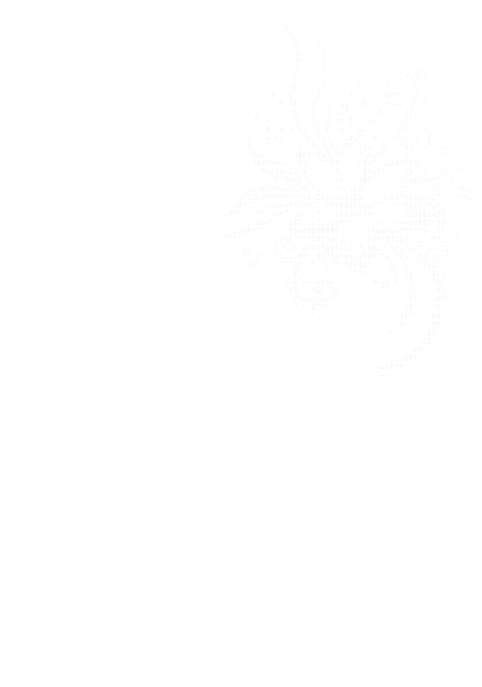

### hi im eva!

current high school sophomore interested in **computational neurology** and **AI/ML**. I enjoy learning and making things :)

### Selected work

#### [Cereva](https://github.com/evadiva3/Cereva)

Built an iOS-first migraine app with visual aura reconstruction, local storage, and model-assisted drafting.

#### [Neuroimaging research](https://github.com/evadiva3/fm-subtype-discovery)

Studied the calibration and sensitivity of cluster tests on normalized neuroimaging representations, with graph ML and fMRI pipelines.

<samp>~~~~~~~~~~</samp>

"And the universe said you are the universe tasting itself, talking to itself, reading its own code

And the universe said I love you because you are love.

And the game was over and the player woke up from the dream. And the player began a new dream. And the player dreamed again, dreamed better. And the player was the universe. And the player was love." -End Poem

 

 

## Tech stack

Stack details

#### Languages

Python · Rust · TypeScript · JavaScript · R · Swift · HTML · CSS · Bash

#### Research & machine learning

PyTorch · PyTorch Geometric · scikit-learn · NumPy · SciPy · pandas · Matplotlib · Nilearn · NiBabel · UMAP · Statsmodels · Optuna · Ray Tune

#### Apps & interfaces

React · React Native · Expo · Tauri · Next.js · Tailwind CSS · Vite · Zod · HealthKit · Canvas 2D

#### Backends & model APIs

FastAPI · Pydantic · Uvicorn · SQLite / SQL · Anthropic API · Ollama

#### Tools & testing

Git · GitHub · GitHub Actions · Docker · QEMU · Node.js · VS Code · Figma · Codex · Claude Code · Jupyter · pytest · Jest · ESLint · Ruff

 

## GitHub activity

  
  &nbsp;
  

Updated daily from GitHub

 

