<!-- GitHub PROFILE README: evadiva3/evadiva3/README.md -->

  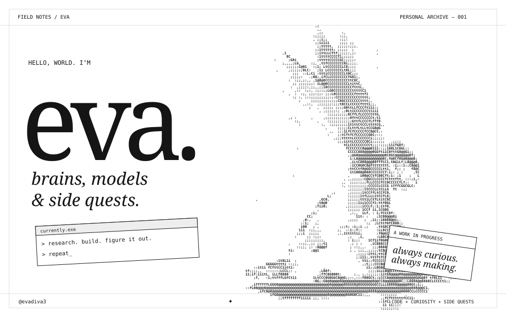

<h2 align="center">hi, i'm eva!</h2>

  high school sophomore into <b>computational neurology</b> and <b>AI / ML</b>. 
  i do research, build things that interest me, and code for fun. 
  currently working on computational neurology research and Cereva.

  <a href="https://github.com/evadiva3?tab=repositories">projects</a> &nbsp; / &nbsp;
  <a href="https://github.com/evadiva3/fm-subtype-discovery">research</a> &nbsp; / &nbsp;
  <a href="https://github.com/evadiva3/Cereva">currently building: cereva</a>

---

### 01 / things taking up my tabs

| project | what i'm working on |
| :--- | :--- |
| [Cereva](https://github.com/evadiva3/Cereva) | an iOS-first migraine app with visual aura reconstruction, local data, and model-assisted drafting |
| [Neuroimaging & cluster-test research](https://github.com/evadiva3/fm-subtype-discovery) | graph ML, fMRI pipelines, and calibration of cluster tests on normalized representations |

### 02 / the stack behind the side quests

**languages**

  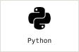
  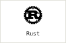
  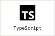
  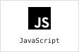
  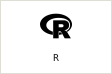
  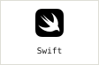
  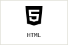
  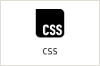
  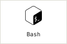

**brains, data & machine learning**

  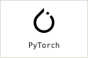
  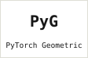
  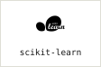
  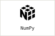
  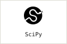
  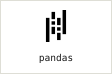
  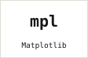
  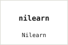
  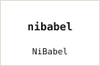
  
  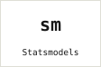
  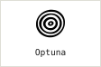
  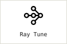

**apps & interfaces**

  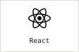
  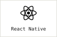
  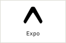
  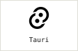
  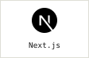
  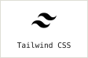
  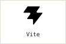
  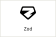
  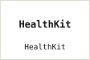
  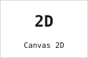

**backends, storage & model APIs**

  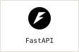
  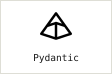
  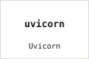
  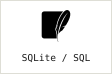
  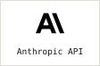
  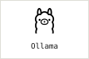

**tools, experiments & shipping**

  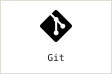
  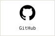
  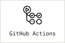
  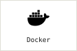
  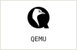
  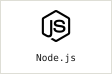
  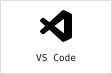
  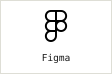
  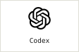
  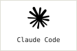
  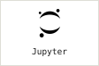
  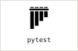
  
  
  

### 03 / a little proof of work

  
  

### 04 / feeding the commit snake

  

---

<samp>brains, bugs, and one more commit. ✦</samp>

