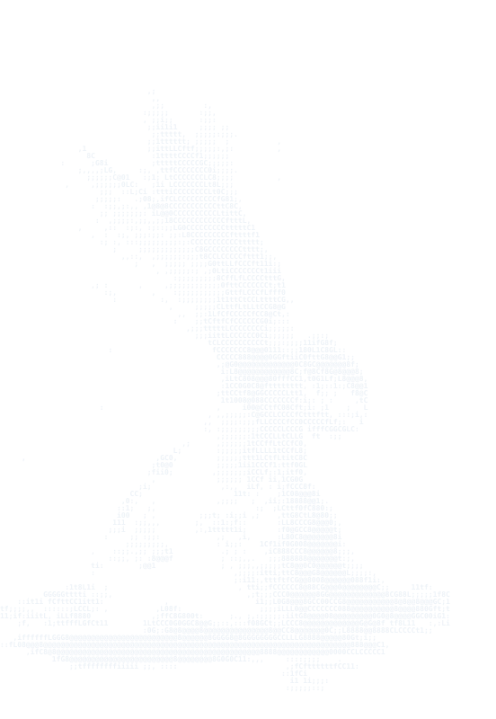

### hi im eva!

current high school sophomore interested in **computational neurology** and **AI/ML**. I enjoy learning and making things :)

### Selected work

#### [Cereva](https://github.com/evadiva3/Cereva)

Built an iOS-first migraine app with visual aura reconstruction, local storage, and model-assisted drafting.

#### [Neuroimaging research](https://github.com/evadiva3/fm-subtype-discovery)

Studied the calibration and sensitivity of cluster tests on normalized neuroimaging representations, with graph ML and fMRI pipelines.

<samp>~~~~~~~~~~</samp>

"And the universe said you are the universe tasting itself, talking to itself, reading its own code

And the universe said I love you because you are love.

And the game was over and the player woke up from the dream. And the player began a new dream. And the player dreamed again, dreamed better. And the player was the universe. And the player was love." -End Poem

 

 

## Tech stack

Stack details

#### Languages

Python · Rust · TypeScript · JavaScript · R · Swift · HTML · CSS · Bash

#### Research & machine learning

PyTorch · PyTorch Geometric · scikit-learn · NumPy · SciPy · pandas · Matplotlib · Nilearn · NiBabel · UMAP · Statsmodels · Optuna · Ray Tune

#### Apps & interfaces

React · React Native · Expo · Tauri · Next.js · Tailwind CSS · Vite · Zod · HealthKit · Canvas 2D

#### Backends & model APIs

FastAPI · Pydantic · Uvicorn · SQLite / SQL · Anthropic API · Ollama

#### Tools & testing

Git · GitHub · GitHub Actions · Docker · QEMU · Node.js · VS Code · Figma · Codex · Claude Code · Jupyter · pytest · Jest · ESLint · Ruff

 

## GitHub activity

  
  &nbsp;
  

Updated daily from GitHub

 

 

## Things I've worked on

Open-source work, including merged contributions and submitted pull requests.

Personal use: ✓ = I use it in my own work; — = contribution work.

### Neuroimaging & brain signals

- **[MNE-Python](https://github.com/mne-tools/mne-python)** · Personal use: ✓ 
  EEG/MEG analysis; submitted fixes for regression statistics, peak finding, and annotations. [My PRs](https://github.com/mne-tools/mne-python/pulls?q=is%3Apr+author%3Aevadiva3)
- **[MNE-NIRS](https://github.com/mne-tools/mne-nirs)** · Personal use: ✓ 
  fNIRS processing; submitted fixes for GLM statistics, wavelength matching, and recording export. [My PRs](https://github.com/mne-tools/mne-nirs/pulls?q=is%3Apr+author%3Aevadiva3)
- **[MNE-Connectivity](https://github.com/mne-tools/mne-connectivity)** · Personal use: ✓ 
  Brain connectivity analysis; merged a cleanup and proposed fixes for degree calculations and logging. [My PRs](https://github.com/mne-tools/mne-connectivity/pulls?q=is%3Apr+author%3Aevadiva3)
- **[MNE-BIDS](https://github.com/mne-tools/mne-bids)** · Personal use: ✓ 
  BIDS-compatible neuroscience datasets; submitted clearer directory error messages. [My PRs](https://github.com/mne-tools/mne-bids/pulls?q=is%3Apr+author%3Aevadiva3)
- **[Nilearn](https://github.com/nilearn/nilearn)** · Personal use: ✓ 
  Neuroimaging and machine learning; merged a contrast-scaling fix and submitted clearer error messages. [My PRs](https://github.com/nilearn/nilearn/pulls?q=is%3Apr+author%3Aevadiva3)
- **[DIPY](https://github.com/dipy/dipy)** · Personal use: — 
  Diffusion and medical imaging; merged a registration convergence-message fix. [My PRs](https://github.com/dipy/dipy/pulls?q=is%3Apr+author%3Aevadiva3)

### Electrophysiology & recording tools

- **[Neo](https://github.com/NeuralEnsemble/python-neo)** · Personal use: — 
  Neurophysiology data and file readers; submitted fixes for Plexon signal blocks and error messages. [My PRs](https://github.com/NeuralEnsemble/python-neo/pulls?q=is%3Apr+author%3Aevadiva3)
- **[Elephant](https://github.com/NeuralEnsemble/elephant)** · Personal use: — 
  Electrophysiology analysis; submitted a fix for invalid iCSD filter settings. [My PRs](https://github.com/NeuralEnsemble/elephant/pulls?q=is%3Apr+author%3Aevadiva3)
- **[ProbeInterface](https://github.com/SpikeInterface/probeinterface)** · Personal use: — 
  Electrode probe geometry and wiring; submitted clearer contact-slicing errors. [My PRs](https://github.com/SpikeInterface/probeinterface/pulls?q=is%3Apr+author%3Aevadiva3)

### Signal processing & time series

- **[NeuroKit2](https://github.com/neuropsychology/NeuroKit)** · Personal use: — 
  Physiological signal processing; submitted fixes for HRV, smoothing, and regression-fit metrics. [My PRs](https://github.com/neuropsychology/NeuroKit/pulls?q=is%3Apr+author%3Aevadiva3)
- **[NiTime](https://github.com/nipy/nitime)** · Personal use: — 
  Neuroscience time series; merged a fix preserving duration when changing a time axis’s sampling interval. [My PRs](https://github.com/nipy/nitime/pulls?q=is%3Apr+author%3Aevadiva3)
- **[FOOOF / specparam](https://github.com/fooof-tools/fooof)** · Personal use: — 
  Neural power-spectrum analysis; submitted fixes for undefined plotting arguments. [My PRs](https://github.com/fooof-tools/fooof/pulls?q=is%3Apr+author%3Aevadiva3)
- **[AntroPy](https://github.com/raphaelvallat/antropy)** · Personal use: — 
  Signal entropy and complexity; submitted support for NumPy scalar inputs. [My PRs](https://github.com/raphaelvallat/antropy/pulls?q=is%3Apr+author%3Aevadiva3)

### Machine learning & statistics

- **[snnTorch](https://github.com/jeshraghian/snntorch)** · Personal use: — 
  Spiking neural networks; submitted fixes for neuron state, spike encoding, monitoring, and memory retention. [My PRs](https://github.com/jeshraghian/snntorch/pulls?q=is%3Apr+author%3Aevadiva3)
- **[Pingouin](https://github.com/raphaelvallat/pingouin)** · Personal use: — 
  Statistical analysis in Python; submitted a clearer missing-dependency error. [My PRs](https://github.com/raphaelvallat/pingouin/pulls?q=is%3Apr+author%3Aevadiva3)
